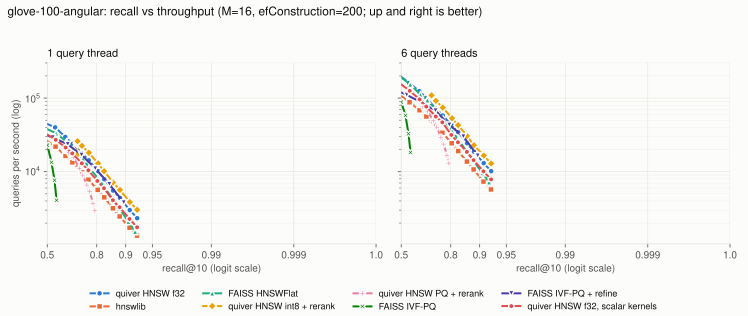

# quiver

**用 Rust 從零寫的精簡向量資料庫：自己實作的 HNSW 索引、手寫 Arm NEON 距離運算、int8 與乘積量化（PQ）、可當機復原的預寫日誌、條件過濾搜尋與 HTTP API，並與 hnswlib、FAISS 做公開透明的基準比較。**

quiver 回答「哪些已存的向量離這個向量最近？」，資料是 `(id, 向量, JSON payload)` 的集合；單一程序就能提供服務，而且程序被強制殺掉時，已經回覆成功的寫入不會遺失。這不是新演算法：hnswlib、FAISS、Qdrant 等早已做同樣的事，規模也大得多。quiver 的價值在於：精簡、測試完整（含測試約 9,500 行 Rust），下面每一項宣稱都有可以自己執行的指令佐證，基準測試也寫明輸在哪裡。

[English](README.md) · [設計文件](docs/DESIGN.md) · [基準測試](docs/benchmarks.md) · [白話導讀](docs/導讀.zh-TW.md)

## 內容

- **HNSW**（Malkov & Yashunin）：鄰居選擇啟發式、可調 `M` / `efConstruction` / `ef`、可同時插入與搜尋（讀取不加鎖、每個節點一把 1 byte 的鎖）、以墓碑（tombstone）標記刪除並在壓實時重建、結構不變量檢查器。暴力搜尋的 flat 索引同時是比較基準與測試的標準答案。
- **距離運算**：f32 的 L2、內積、cosine，int8 的內積與 L2，以及 Hamming 距離。手寫 NEON（CPU 支援 FEAT_DotProd 時用 `SDOT`/`UDOT`）、x86-64 的 AVX2+FMA、純量參考版，執行時自動選用。以 f64 參考值對隨機長度、尾端與未對齊輸入做性質測試（property test）。
- **量化**：每個向量各自縮放的 int8（距離用 `SDOT` 算）與乘積量化（k-means 碼本、查表），圖走訪用壓縮距離，最後用原始向量重排。
- **儲存**：有 CRC 檢查的預寫日誌（WAL）、group commit、macOS 上用 `F_FULLFSYNC`；不可變、以 mmap 對應的段檔，每一區塊都有檢查碼；原子性替換的 manifest、背景壓實、重播日誌的當機復原。有一個測試在寫入壓力下用 SIGKILL 殺掉伺服器，之後逐筆檢查已確認的寫入。
- **過濾**：依 payload 欄位（等於、`in`、範圍、`and`/`or`/`not`），每個段依「精確的符合筆數」選策略：符合的少就暴力搜尋，多就走過濾版的圖搜尋。
- **介面**：HTTP/JSON 伺服器（`quiver serve`）、命令列工具、Rust 函式庫。

## 示範

實際的操作紀錄（`quiver serve` 跑在臨時埠，再用命令列操作）：

```console
$ quiver serve --data ./data --listen 127.0.0.1:0 --port-file port &
quiver 0.1.0 listening on http://127.0.0.1:58185 (data: ./data)
$ export QUIVER_URL=http://$(cat port)
$ quiver create docs --dim 4 --metric cosine
{ "created": "docs" }
$ quiver import docs points.jsonl
imported 4 points in 0.0s
$ quiver search docs --vector 1,0.2,0,0 --k 2 \
    --filter '{"and":[{"field":"lang","eq":"en"},{"field":"year","gte":2020}]}'
{
  "hits": [
    { "distance": 0.16794973611831665, "id": 4,
      "payload": { "lang": "en", "tags": ["new"], "year": 2024 } },
    { "distance": 0.8038838505744934, "id": 3,
      "payload": { "lang": "en", "year": 2023 } }
  ],
  "plan": [ { "live": 4, "matched": 2, "segment": 1, "strategy": "brute" } ],
  "took_us": 25
}
$ kill -TERM %1        # 收到 SIGTERM 會先做檢查點再結束
quiver: shutting down, checkpointing collections
```

`plan` 欄位列出每個段有幾筆符合條件、用了哪一種策略。

## 運作方式

```
 寫入 ─► 驗證 ─► 寫 WAL 並同步（group commit）─► 插入 HNSW（成長中的段）─► 依 LSN 提交 ─► 回覆
 成長段滿了 ─► 封存：段檔（可含 int8/PQ 碼）、新 WAL、原子性 manifest
 墓碑 > 20% 或段數 > 8 ─► 壓實：只用存活資料重建新圖，短暫切換
 搜尋 ─► 每個段：過濾位元集 ─► 暴力或 HNSW（可量化＋重排）─► 合併
```

- **並行**：鄰居清單是原子陣列，寫入者一次只鎖一個節點，讀取者完全不鎖，靠 `Release`/`Acquire` 記憶體順序保證；讀到的鄰居可能稍舊，但絕不會是還沒初始化的節點。壓力測試抓到一個真的競爭條件（新節點可能把自己選成鄰居；hnswlib 在同樣情況下會丟出例外），已修正並納入測試。
- **持久性**：寫入先記進日誌並同步，才動記憶體，套用完才回覆。並行的寫入共用同步。同一個 id 的競爭以日誌序號（LSN）決定，所以記憶體狀態永遠等於「照日誌順序重播一次」的結果。
- **過濾**：每個段用 payload 索引把條件算成精確的位元集。暴力搜尋約要 `符合筆數` 次距離計算，過濾版圖搜尋約要 `ef * 2M * 存活筆數 / 符合筆數` 次；quiver 在交叉點 `sqrt(ef * 2M * 存活筆數)` 以下用暴力搜尋。

細節（記憶體順序的論證、檢查點的當機時間點、壓實時的並行寫入、被放棄的替代方案）見[設計文件](docs/DESIGN.md)。

## 結果

在 Apple M5（macOS 27，與其他工作共用機器）上量測，所有 HNSW 都用 M = 16、efConstruction = 200、6 個執行緒建索引；完整方法、指令與所有數字見 [docs/benchmarks.md](docs/benchmarks.md)，原始資料在 `bench/results/`。

<picture>
  <source media="(prefers-color-scheme: dark)" srcset="bench/results/ann-glove-100-angular-dark.svg">
  
</picture>

達到該召回率的量測點中最高的每秒查詢數（1 個查詢執行緒 / 6 個）：

| | GloVe-100（118 萬筆，cosine）recall 0.90 | Fashion-MNIST（6 萬筆，L2）recall 0.99 | 建索引秒數（GloVe / Fashion） |
|---|---|---|---|
| quiver HNSW f32 | 3,006 / 13,058 | 15,685 / 57,712 | 50.6 / 3.6 |
| quiver HNSW int8 + 重排 | 3,860 / 16,544 | 26,525 / 104,997 | 50.6 / 3.6 |
| FAISS HNSWFlat | 2,095 / 9,602 | 17,566 / 50,646 | 59.1 / 3.7 |
| hnswlib | 1,730 / 7,322 | 5,942 / 28,322 | 95.5 / 7.5 |
| quiver HNSW f32，純量距離 | 2,276 / 10,105 | 5,959 / 28,810 | 71.3 / 7.7 |
| FAISS IVF-PQ + refine | （最高 recall 0.895） | 2,760 / 10,428 | 11.7 / 7.0 |

這些數字說明了什麼、沒說明什麼：

- **hnswlib 沒有 NEON 程式碼**（它的 SIMD 只支援 x86，arm64 版跑的是一般迴圈）。讓 quiver 也用純量距離時，在 Fashion-MNIST 上兩者相差不到 3%，所以 quiver 在這台機器上贏 hnswlib，靠的是距離運算，不是更好的圖。
- **quiver 輸的地方**：Fashion-MNIST 單執行緒時 FAISS HNSWFlat 快 12-15%；quiver 的 PQ 模式在 GloVe 上召回率只到 0.79（FAISS IVF-PQ + refine 為 0.895），而且整張 HNSW 圖都在記憶體裡（222 MB，FAISS IVF-PQ 只要 41 MB）；FAISS IVF-PQ 建索引比任何 HNSW 快 4 倍。
- **int8 + 重排**是 quiver 在這兩組資料上最好的模式：同樣召回率下比 f32 快，Fashion-MNIST 常駐記憶體從 198 MB 降到 57 MB（f32 向量留在 mmap 的檔案裡，只在重排時讀）。
- GloVe 上所有 HNSW 在 M = 16 時召回率都停在約 0.925；要更高需要更大的 M。

**距離運算**（每次呼叫奈秒，輸入都在 L1 快取，所有實作用同一套量測；NumKong 7 刻意用 f64 累加 f32，SimSIMD 6.5 只用一個累加器）：

| | 維度 | 純量 | quiver NEON | NumKong 7 | SimSIMD 6 |
|---|---|---|---|---|---|
| L2 f32 | 768 | 298.5 | 40.3 | 262.4 | 115.2 |
| 內積 f32 | 768 | 303.1 | 40.7 | 145.0 | 101.6 |
| L2 int8 | 768 | 45.2 | 9.9 | 15.1 | 15.2 |

**過濾搜尋**依每個段的精確符合筆數選暴力或圖搜尋。在兩組資料上，從 50% 到 0.1% 的每個選擇率，它都選中了比較快的那一種，交叉點以下召回率為 1.0；單純的「先搜再過濾」在 0.1% 選擇率時召回率掉到 0.40-0.42。

**持久性**：SIGKILL 測試（在並行寫入、檢查點與壓實進行中殺 4 輪）每次約驗證 8,000 筆已確認的資料與 300 筆已確認的刪除；換六個亂數種子都通過。

**SME**：M5 有 SME2，但先前在這台機器上的調查發現，進出 streaming mode 的成本比單一對向量的距離計算還高，而 HNSW 一次只算一對，所以 quiver 不使用 SME。

## API

| 方法 | 路徑 | 內容 |
|---|---|---|
| `PUT` | `/collections/{name}` | `{"dim": 768, "metric": "cosine", "m": 16, "ef_construction": 200, "ef_search": 64, "quantization": {"type": "int8"}, "rerank": 4, "segment_rows": 100000}`（除 `dim`/`metric` 外皆可省略） |
| `GET` / `DELETE` | `/collections/{name}` | 統計 / 刪除集合 |
| `PUT` | `/collections/{name}/points` | `{"points": [{"id": 1, "vector": [...], "payload": {...}}]}`（新增或取代，最多 10,000 筆） |
| `POST` | `/collections/{name}/points/delete` | `{"ids": [1, 2]}` |
| `POST` | `/collections/{name}/points/get` | `{"ids": [1, 2], "with_vector": true}` |
| `POST` | `/collections/{name}/search` | `{"vector": [...], "k": 10, "ef": 64, "filter": {...}, "with_payload": true}` |
| `POST` | `/collections/{name}/checkpoint` / `/compact` | |

距離一律「越小越近」：L2 為平方距離、內積為 `-dot`、cosine 為 `1 - cos`。函式庫用法見 [examples/library.rs](examples/library.rs)。

## 建置與測試

需要 Rust 1.98 以上（NEON 內積指令的 intrinsics 在 1.98 穩定）。

```sh
make build        # cargo build --release
make test         # 單元、性質與整合測試，包含 SIGKILL 測試
make lint         # rustfmt --check 與 clippy -D warnings
QUIVER_KERNELS=scalar cargo test --release --lib   # 用純量距離再跑一次
```

CI 在 macOS（Apple Silicon）、Linux AArch64、Linux x86-64（AVX2 路徑）上跑測試。隨機測試用固定種子，失敗時印出種子；`QUIVER_TEST_SEED` 可重現。

## 限制

- 每個集合只有一個成長中的段；搜尋在呼叫的執行緒上一段一段依序做。
- 壓實每次都合併所有封存段，沒有分層合併策略，成本隨資料量成長。
- 對非常大的段下非常嚴格的條件時，會退回掃描所有符合的資料（正確但線性）；沒有 Qdrant 那種依 payload 加的額外圖邊。
- SIGKILL 測試涵蓋程序當機；斷電時的持久性依賴 `F_FULLFSYNC`/`fdatasync` 與設計文件中的寫入順序論證，沒有實際拔電測試。
- 沒有帳號驗證、TLS、複寫或分片；id 為 `u64`。

## 相關專案

- [hnswlib](https://github.com/nmslib/hnswlib)：演算法作者的 HNSW 參考實作；quiver 的圖程式結構（啟發式、每節點鎖、入口點鎖）參考它。它的 SIMD 只支援 x86。
- [FAISS](https://github.com/facebookresearch/faiss)：HNSW、IVF、PQ 等，距離運算高度最佳化；本專案主要的比較對象。
- [USearch](https://github.com/unum-cloud/usearch)：使用 SimSIMD/NumKong 運算核心的精簡單檔 HNSW 引擎。
- [Qdrant](https://github.com/qdrant/qdrant)、[Milvus](https://github.com/milvus-io/milvus)、[LanceDB](https://github.com/lancedb/lancedb)、[pgvector](https://github.com/pgvector/pgvector)：正式上線用的向量資料庫，功能遠多於 quiver。
- [NumKong](https://github.com/ashvardanian/NumKong) / [SimSIMD](https://github.com/ashvardanian/SimSIMD)：可攜的 SIMD 距離運算函式庫；上面已與 quiver 比較。

除了「精簡、測試完整、基準透明的實作」之外，quiver 不宣稱任何新穎性。

## 授權

MIT。Copyright (c) 2026 useless-husband。
