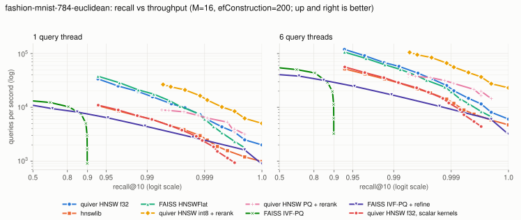

# Benchmarks

Everything here was measured on one machine and can be reproduced with the
commands below. Numbers are from a machine that is shared with other work
(other processes were running, load average about 3 on 10 cores during the
kernel runs); treat differences under about 10% as noise.

* **Hardware:** Apple M5 (10 cores: 4 performance + 6 efficiency), 16 GB, macOS 27.0.
* **Software:** Rust 1.98.1 (release profile, thin LTO); Python 3.13 with
  hnswlib 0.8.0 (built from source by pip), faiss-cpu 1.15.1 (arm64 wheel),
  numpy 2.5.
* **Datasets:** ann-benchmarks HDF5 files, downloaded at benchmark time and
  converted to `.fbin` (not in the repository):
  `fashion-mnist-784-euclidean` (60,000 x 784, L2) and `glove-100-angular`
  (1,183,514 x 100, cosine), 10,000 queries each, ground truth from the files.
* **Index parameters:** M = 16, efConstruction = 200 for every HNSW; `ef` swept
  over 10..512. FAISS IVF-PQ: `nlist = 4 sqrt(n)`, `m = dim / 4` sub-quantizers
  of 8 bits, `nprobe` swept over 1..128, with and without `IndexRefineFlat`
  (`k_factor` 10). quiver PQ uses the same `m`, re-ranking 4 x k candidates.
* **Threads:** every library built with 6 threads and searched with 1 and 6
  threads (hnswlib `num_threads`, `faiss.omp_set_num_threads`, quiver worker
  threads). Baselines are timed on one batch call per point, quiver on a loop
  over the queries with per-query timing; both after a 500-query warm-up.
* **Recall:** recall@10, the fraction of the true 10 nearest ids returned.

```sh
python bench/ann/datasets.py --data-dir DATA fashion-mnist-784-euclidean glove-100-angular
PY=/path/to/venv/python BUILD_THREADS=6 THREADS=1,6 bench/ann/run.sh DATA
python bench/ann/plot.py && python bench/ann/summarize.py
```

Raw data: `bench/results/ann-*.csv` (one row per measured point, including
p50/p99 latency for quiver and peak RSS). Charts: `bench/results/ann-*-light.svg`
/ `-dark.svg`.

## Recall vs throughput

<picture>
  <source media="(prefers-color-scheme: dark)" srcset="../bench/results/ann-glove-100-angular-dark.svg">
  
</picture>

<picture>
  <source media="(prefers-color-scheme: dark)" srcset="../bench/results/ann-fashion-mnist-784-euclidean-dark.svg">
  
</picture>

Best measured QPS among the points that reach each recall level ("-": no
measured point reaches it; GloVe tops out near 0.925 at M = 16 for every HNSW
implementation). "index MB" is what each library reports: quiver's estimate
of vectors + graph (for the quantized variants: graph + codes, with the f32
vectors left in the memory-mapped segment file for re-ranking), hnswlib's
saved file size, FAISS's serialized size.

### fashion-mnist-784-euclidean

| index | threads | QPS @ recall 0.80 | QPS @ recall 0.90 | QPS @ recall 0.95 | QPS @ recall 0.99 | max recall | build s (6 thr) | index MB |
|---|---|---|---|---|---|---|---|---|
| quiver HNSW f32 | 1 | 33,785 | 33,785 | 24,885 | 15,685 | 0.9999 | 3.6 | 198 |
| hnswlib | 1 | 10,681 | 10,681 | 8,525 | 5,942 | 0.9999 | 7.5 | 197 |
| FAISS HNSWFlat | 1 | 37,815 | 37,815 | 28,605 | 17,566 | 0.9998 | 3.7 | 197 |
| quiver HNSW int8 + rerank | 1 | 26,525 | 26,525 | 26,525 | 26,525 | 0.9999 | 3.6 | 57 |
| quiver HNSW PQ + rerank | 1 | 8,922 | 8,922 | 8,922 | 8,922 | 0.9998 | 3.6 | 22 |
| FAISS IVF-PQ | 1 | 10,248 | - | - | - | 0.8989 | 7.0 | 16 |
| FAISS IVF-PQ + refine | 1 | 8,168 | 6,360 | 6,360 | 2,760 | 1.0000 | 7.0 | 16 |
| quiver HNSW f32, scalar kernels | 1 | 10,960 | 10,960 | 8,912 | 5,959 | 0.9997 | 7.7 | 198 |
| quiver HNSW f32 | 6 | 119,519 | 119,519 | 91,079 | 57,712 | 0.9999 | 3.6 | 198 |
| hnswlib | 6 | 51,740 | 51,740 | 41,594 | 28,322 | 0.9999 | 7.5 | 197 |
| FAISS HNSWFlat | 6 | 106,231 | 106,231 | 81,102 | 50,646 | 0.9998 | 3.7 | 197 |
| quiver HNSW int8 + rerank | 6 | 104,997 | 104,997 | 104,997 | 104,997 | 0.9999 | 3.6 | 57 |
| quiver HNSW PQ + rerank | 6 | 41,541 | 41,541 | 41,541 | 41,541 | 0.9998 | 3.6 | 22 |
| FAISS IVF-PQ | 6 | 43,583 | - | - | - | 0.8989 | 7.0 | 16 |
| FAISS IVF-PQ + refine | 6 | 31,716 | 24,462 | 24,462 | 10,428 | 1.0000 | 7.0 | 16 |
| quiver HNSW f32, scalar kernels | 6 | 56,305 | 56,305 | 44,250 | 28,810 | 0.9997 | 7.7 | 198 |

### glove-100-angular

| index | threads | QPS @ recall 0.80 | QPS @ recall 0.90 | QPS @ recall 0.95 | QPS @ recall 0.99 | max recall | build s (6 thr) | index MB |
|---|---|---|---|---|---|---|---|---|
| quiver HNSW f32 | 1 | 10,190 | 3,006 | - | - | 0.9255 | 50.6 | 666 |
| hnswlib | 1 | 5,658 | 1,730 | - | - | 0.9251 | 95.5 | 649 |
| FAISS HNSWFlat | 1 | 8,020 | 2,095 | - | - | 0.9213 | 59.1 | 644 |
| quiver HNSW int8 + rerank | 1 | 12,925 | 3,860 | - | - | 0.9254 | 50.6 | 320 |
| quiver HNSW PQ + rerank | 1 | - | - | - | - | 0.7916 | 50.6 | 222 |
| FAISS IVF-PQ | 1 | - | - | - | - | 0.5648 | 11.7 | 41 |
| FAISS IVF-PQ + refine | 1 | 6,749 | - | - | - | 0.8950 | 11.7 | 41 |
| quiver HNSW f32, scalar kernels | 1 | 7,465 | 2,276 | - | - | 0.9253 | 71.3 | 666 |
| quiver HNSW f32 | 6 | 42,556 | 13,058 | - | - | 0.9255 | 50.6 | 666 |
| hnswlib | 6 | 24,305 | 7,322 | - | - | 0.9251 | 95.5 | 649 |
| FAISS HNSWFlat | 6 | 35,585 | 9,602 | - | - | 0.9213 | 59.1 | 644 |
| quiver HNSW int8 + rerank | 6 | 53,119 | 16,544 | - | - | 0.9254 | 50.6 | 320 |
| quiver HNSW PQ + rerank | 6 | - | - | - | - | 0.7916 | 50.6 | 222 |
| FAISS IVF-PQ | 6 | - | - | - | - | 0.5648 | 11.7 | 41 |
| FAISS IVF-PQ + refine | 6 | 29,947 | - | - | - | 0.8950 | 11.7 | 41 |
| quiver HNSW f32, scalar kernels | 6 | 31,576 | 10,105 | - | - | 0.9253 | 71.3 | 666 |

## Reading the results honestly

* **hnswlib has no NEON code.** Its SSE/AVX kernels are compiled only on x86;
  the arm64 build used here contains just the plain `L2Sqr` loop (checked in
  the disassembly). The `quiver HNSW f32, scalar kernels` rows run quiver with
  its scalar reference kernels to separate the graph from the SIMD code: on
  Fashion-MNIST the two are within 3% of each other single-threaded (10,960
  vs 10,681 QPS at recall 0.90; 5,959 vs 5,942 at 0.99). quiver's advantage
  over hnswlib on this machine is its distance kernels, not a better graph.
* **Where quiver loses:**
  * FAISS HNSWFlat is 12-15% faster single-threaded on Fashion-MNIST at every
    recall level (17,566 vs 15,685 QPS at 0.99). With 6 threads quiver is
    ahead (57,712 vs 50,646). On GloVe quiver is ahead in both settings; the
    cause was not investigated.
  * quiver's PQ mode is the weakest option: with `m = dim / 4` and 4 x k
    re-ranked candidates it reaches only recall 0.79 on GloVe (FAISS IVF-PQ +
    refine: 0.895), and on Fashion-MNIST it is slower than plain f32 (the
    196 x 256 ADC table no longer fits in L1). It saves memory, not time, and
    its resident size is dominated by the HNSW graph: 222 MB on GloVe against
    41 MB for FAISS IVF-PQ.
  * FAISS IVF-PQ builds 4x faster than any HNSW here (11.7 s vs 50.6 s on GloVe).
* **int8 + re-rank is the best quiver variant on both sets:** on Fashion-MNIST
  26,451 QPS at recall 0.995 (f32: 15,685 at 0.99) with 57 MB resident
  instead of 198 MB; on GloVe 12,925 vs 10,190 QPS at 0.80. Its curve starts
  at higher recall because it always keeps at least 4 x k = 40 candidates.
* quiver builds in 3.6 s / 50.6 s (Fashion / GloVe) against hnswlib's 7.5 s /
  95.5 s and FAISS HNSW's 3.7 s / 59.1 s.

## Distance kernels

`quiver bench kernels` and `bench/kernels-compare` (a separate crate that links
NumKong 7.8.3 and SimSIMD 6.5.16 through their Rust bindings, default build
flags) time each function on 32 L1-resident input pairs, the pair index passed
through `black_box`, median of 7 runs of 2 million calls. All functions are
called through a function pointer or FFI, none is inlined. Both libraries
report NEON (and NumKong SME) support at run time. Nanoseconds per call:

| kernel | dim | scalar | quiver NEON | NumKong 7 | SimSIMD 6 |
|---|---|---|---|---|---|
| l2sq_f32 | 128 | 28.3 | 6.4 | 26.8 | 11.6 |
| l2sq_f32 | 768 | 298.5 | 40.3 | 262.4 | 115.2 |
| l2sq_f32 | 1536 | 683.5 | 87.4 | 595.9 | 256.5 |
| dot_f32 | 128 | 25.5 | 5.9 | 16.3 | 11.0 |
| dot_f32 | 768 | 303.1 | 40.7 | 145.0 | 101.6 |
| dot_f32 | 1536 | 668.1 | 86.7 | 313.1 | 248.0 |
| cos_f32 | 128 | 54.2 | 10.5 | 39.5 | 14.8 |
| cos_f32 | 768 | 418.4 | 69.1 | 303.4 | 118.7 |
| cos_f32 | 1536 | 844.5 | 151.9 | 642.3 | 286.6 |
| dot_i8 | 128 | 2.3 | 2.7 | 3.4 | 3.9 |
| dot_i8 | 768 | 10.5 | 8.5 | 14.3 | 14.8 |
| dot_i8 | 1536 | 20.7 | 18.5 | 35.6 | 36.0 |
| l2sq_i8 | 128 | 8.0 | 2.7 | 3.6 | 4.0 |
| l2sq_i8 | 768 | 45.2 | 9.9 | 15.1 | 15.2 |
| l2sq_i8 | 1536 | 89.7 | 21.8 | 37.3 | 37.8 |

* NEON f32 is about 4x (128-d) to 7.8x (1536-d) faster than the scalar loop.
* The "scalar" int8 dot product is auto-vectorised by LLVM (with `SDOT`, which
  the Apple target enables): at 128-d the hand-written kernel is 15% slower
  than LLVM's loop, at 768-1536-d 10-30% faster. For int8 L2, where LLVM does
  not find the `SABD`/`UDOT` idiom, it is 3-4.6x faster.
* NumKong 7 accumulates f32 inputs in f64 (two lanes per step), by design for
  accuracy; its f32 numbers measure a more precise computation.
* SimSIMD 6.5's NEON f32 loops use a single accumulator; quiver's four
  independent accumulators are 1.8x (128-d) to 2.9x (768-d) faster. Eight accumulators measured
  no faster than four.
* Raw data: `bench/results/kernels.csv` (every quiver table, including
  `neon` without dot-product instructions) and `kernels-compare.csv`.

**SME.** The M5 implements SME2. A prior investigation on this machine found
SME a poor fit for single-pair distances (the cost of entering and leaving
streaming mode exceeds a whole 128-d dot product, and graph search computes
one pair at a time). quiver has no SME kernels and no measurement here
contradicts that finding; SME would pay off for batched query x block work.

## Filtered search

`quiver bench filter` loads a dataset into a real collection (sealed,
memory-mapped segment), gives every point a uniformly random `bucket` field,
and searches with `bucket < t` for several selectivities (ef = 64, k = 10,
single thread), against exact filtered ground truth. "post-filter" is the
naive alternative: an unfiltered search for `k / selectivity` candidates
(at most 4096), keeping the matching ones.

```sh
quiver bench filter --base DATA/fashion-mnist-784-euclidean.base.fbin \
  --queries DATA/fashion-mnist-784-euclidean.query.fbin --metric l2 --nq 1000
```

### fashion-mnist-784-euclidean (60,000 rows, 1,000 queries)

| selectivity | matching rows | auto picks | auto recall / QPS | graph recall / QPS | brute recall / QPS | post-filter recall / QPS |
|---|---|---|---|---|---|---|
| 50% | 30,103 | graph | 0.9989 / 5,500 | 0.9989 / 5,392 | 1.0000 / 368 | 0.9187 / 10,000 |
| 20% | 12,045 | graph | 0.9995 / 2,837 | 0.9995 / 2,915 | 1.0000 / 580 | 0.8818 / 9,829 |
| 10% | 6,045 | brute | 1.0000 / 2,155 | 1.0000 / 1,688 | 1.0000 / 2,084 | 0.8797 / 6,756 |
| 5% | 2,986 | brute | 1.0000 / 5,584 | 0.9999 / 968 | 1.0000 / 5,682 | 0.8685 / 4,071 |
| 2% | 1,182 | brute | 1.0000 / 15,526 | 1.0000 / 405 | 1.0000 / 15,593 | 0.8460 / 1,944 |
| 1% | 566 | brute | 1.0000 / 31,480 | 1.0000 / 195 | 1.0000 / 30,988 | 0.8519 / 1,105 |
| 0.5% | 275 | brute | 1.0000 / 61,040 | 1.0000 / 90 | 1.0000 / 60,708 | 0.8414 / 598 |
| 0.2% | 116 | brute | 1.0000 / 118,826 | 1.0000 / 34 | 1.0000 / 119,238 | 0.7861 / 304 |
| 0.1% | 53 | brute | 1.0000 / 197,974 | 1.0000 / 20 | 1.0000 / 197,616 | 0.3954 / 304 |

The cost model puts the crossover at `sqrt(ef * 2M * live)` = 11,085 matching
rows (18.5%). Measured, brute force is faster at 10% (6,045 rows) and graph
traversal at 20% (12,045 rows), so the automatic choice picks the faster
strategy at every measured point and the default factor (1.0) was kept.
Graph traversal alone stays accurate at low selectivity but slows down
sharply (20 QPS at 0.1%: it expands most of the graph); post-filtering is
fast but loses recall as the filter tightens (0.40 at 0.1%).

### glove-100-angular (1,183,514 rows, 300 queries)

| selectivity | matching rows | auto picks | auto recall / QPS | graph recall / QPS | brute recall / QPS | post-filter recall / QPS |
|---|---|---|---|---|---|---|
| 50% | 591,840 | graph | 0.8070 / 2,348 | 0.8070 / 2,167 | 1.0000 / 148 | 0.6900 / 11,741 |
| 20% | 236,947 | graph | 0.8543 / 2,446 | 0.8543 / 2,501 | 1.0000 / 128 | 0.6393 / 11,525 |
| 10% | 118,099 | graph | 0.8777 / 1,744 | 0.8777 / 1,737 | 1.0000 / 226 | 0.6523 / 8,053 |
| 5% | 59,155 | graph | 0.9057 / 1,002 | 0.9057 / 1,003 | 1.0000 / 521 | 0.6830 / 4,748 |
| 2% | 23,499 | brute | 1.0000 / 2,942 | 0.9350 / 450 | 1.0000 / 3,235 | 0.7177 / 2,138 |
| 1% | 11,783 | brute | 1.0000 / 6,508 | 0.9587 / 234 | 1.0000 / 6,486 | 0.7490 / 1,136 |
| 0.5% | 5,959 | brute | 1.0000 / 11,875 | 0.9770 / 128 | 1.0000 / 11,896 | 0.7827 / 611 |
| 0.1% | 1,244 | brute | 1.0000 / 27,855 | 0.9967 / 29 | 1.0000 / 27,276 | 0.4187 / 304 |

Crossover by the model: 49,240 matching rows (4.2%). Measured, graph
traversal is faster at 5% (1,003 vs 521 QPS) and brute force at 2% (3,235 vs
450), so again the automatic choice is the faster one on both sides. Above the
crossover the filtered recall is limited by the graph at ef = 64 on this hard
dataset (0.81-0.91; the unfiltered search measures 0.76 at the same ef), and a
larger `ef` raises it as in the unfiltered curves; below it, brute force is
exact. Brute-force throughput is not monotonic in the match
count at 20-50% (noise on a shared machine).

## Durability

`cargo test --release --test crash` runs the SIGKILL test: 6 writer threads
(upsert batches of 1-20 points, deletes) plus checkpoint and compaction
requests, killed at a random moment, four rounds on one data directory. A
typical run verifies about 8,000 live and 300 deleted points after the
restarts; six different seeds passed. The WAL group commit shares one
`F_FULLFSYNC` among concurrent writers (in the unit test, 320 commits from 8
threads used 83 syncs).
